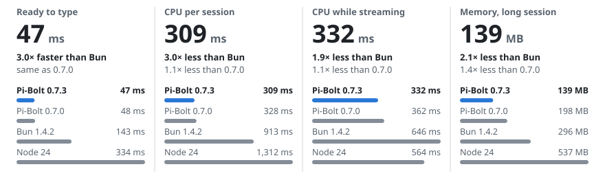
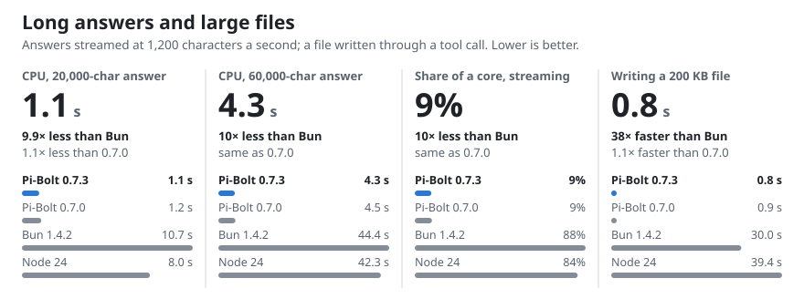
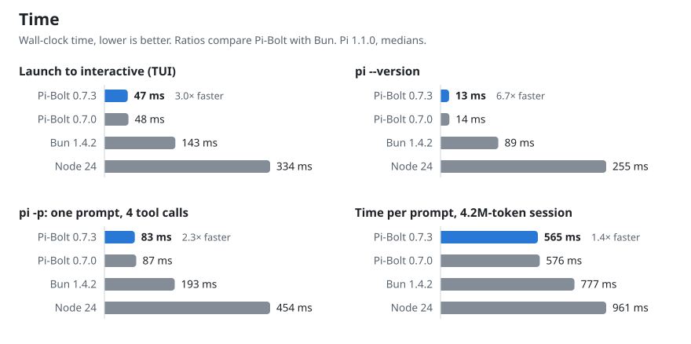
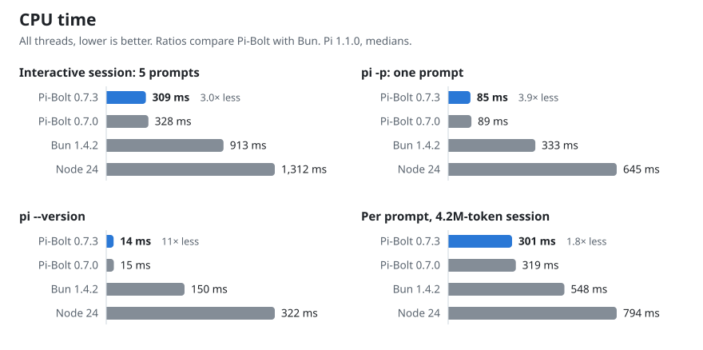
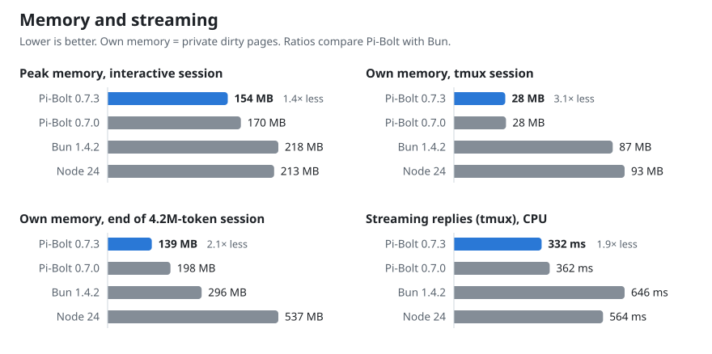

<p align="center">
  <a href="https://github.com/opensec-git/Pi-Bolt">
    
  </a>
</p>
<p align="center">
  <a href="https://github.com/opensec-git/Pi-Bolt/actions/workflows/ci.yml"></a>
  <a href="https://github.com/opensec-git/Pi-Bolt/releases/latest"></a>
  <a href="https://www.npmjs.com/package/pi-bolt"></a>
  <a href="https://www.npmjs.com/package/pi-bolt"></a>
  <a href="https://github.com/opensec-git/Pi-Bolt/stargazers"></a>
  <a href="sources.json"></a>
  <a href="#requirements"></a>
  <a href="#requirements"></a>
  <a href="#requirements"></a>
  <a href="LICENSE"></a>
</p>

<h1 align="center">Pi-Bolt</h1>

<p align="center"><b>The <a href="https://github.com/earendil-works/pi">Pi</a> coding agent, compiled ahead of time to native code.</b><br>
One executable for Linux x86-64, macOS on Apple silicon and Windows x64. No JIT, no Node.js or Bun required.</p>

Pi-Bolt is the Pi you already use, with the same commands, sessions, settings, providers and extensions. Every function is
compiled to machine code when the executable is built, so nothing is parsed or JIT-compiled at launch. It starts two to three
times sooner than Pi on Bun, uses about a third of its CPU over a session, and handles long answers and large files seven to
thirty-five times more cheaply.

<picture>
  <source media="(prefers-color-scheme: dark)" srcset="docs/images/bench-hero-dark.svg">
  
</picture>

<sub>AMD EPYC 7B13, Linux. Pi-Bolt 0.8.0 against Pi 1.1.0 as released on stock Bun 1.4.2 and Node 24; medians of interleaved runs,
lower is better. See [Benchmarks](#benchmarks).</sub>

> [!NOTE]
> Pi-Bolt is an independent fork of [Pi](https://github.com/earendil-works/pi), not affiliated with Pi's authors or with Oven.

## Install

```bash
curl -fsSL https://pi-bolt.opensec.in/install.sh | sh
```

On Windows, in PowerShell:

```powershell
powershell -c "[Net.ServicePointManager]::SecurityProtocol = [Net.ServicePointManager]::SecurityProtocol -bor 3072; irm https://pi-bolt.opensec.in/install.ps1 | iex"
```

or `npm install -g --allow-scripts=pi-bolt pi-bolt`, or `bun add -g --trust pi-bolt` (the flags let the package manager run the
script that puts the Windows executable in place). Then run `pi-bolt` in your project. Your Pi configuration in `~/.pi/agent` is
used as is; new to Pi? Run `/login` to connect a provider. `pi-bolt update` installs the latest release.

The installer verifies the release signature and offers three optional extensions by OpenSec:

| Extension | What it does |
|---|---|
| [`opensec-pi-subagents`](https://www.npmjs.com/package/opensec-pi-subagents) | Specialized agents in separate sessions, parallel workflows and scheduled jobs |
| [`opensec-pi-todo`](https://www.npmjs.com/package/opensec-pi-todo) | A todo list for the model, shown as a live panel above the editor |
| [`opensec-pi-fff`](https://www.npmjs.com/package/opensec-pi-fff) | pi-fff's fast fuzzy find, grep and `@`-mentions, at full speed on the default build |

### JIT build, for heavy plugins

The default build has no JIT: Pi's own code is compiled machine code, and an extension loaded at run time is interpreted. Light
extensions don't notice. For extensions that do heavy work (search, parsing) or use `bun:ffi`, install the JIT
build. (For pi-fff, `opensec-pi-fff` is as fast on the default build as pi-fff is with the JIT.) Pi itself stays compiled, so it is within about 5% of the default.

```bash
curl -fsSL https://pi-bolt.opensec.in/install.sh | PIBOLT_VARIANT=arm64-jit sh   # macOS
curl -fsSL https://pi-bolt.opensec.in/install.sh | PIBOLT_VARIANT=x64-jit sh     # Linux
```

On Windows, run `$env:PIBOLT_VARIANT = "x64-jit"` before the PowerShell command. With npm, keep `PIBOLT_VARIANT` set in your
shell profile; it is read on every run. `pi-bolt --version` then ends in `JIT on`, and `pi-bolt update` keeps the build you chose.

<details>
<summary>Manual download</summary>

Download a build from the [latest release](https://github.com/opensec-git/Pi-Bolt/releases/latest), check it against
`SHA256SUMS`, unpack it and run `./pi` (on Windows, `pi-bolt.exe`).

| Download | For |
|---|---|
| `pi-bolt-linux-x64.tar.xz` | **Linux**, CPUs with AVX2 (Intel Haswell, AMD Zen and later) |
| `pi-bolt-linux-x64-baseline.tar.xz` | Linux, any x86-64 CPU |
| `pi-bolt-darwin-arm64.tar.xz` | **macOS**, Apple silicon |
| `pi-bolt-win32-x64.zip` | **Windows** x64; compiled code on CPUs with AVX2, bytecode on others |

`-jit` builds are for heavy use of plugins loaded at run time; the runtime archive is for [compiling plugins in](docs/PLUGINS.md).

</details>

### Requirements

- **Linux** x86-64 with glibc 2.17 or later (Ubuntu 20.04+, Debian 11+, RHEL/Rocky 8+, Amazon Linux 2). musl is not supported.
- **macOS** 13 or later on Apple silicon. Install with the installer or npm ([Troubleshooting](docs/TROUBLESHOOTING.md#macos)).
- **Windows** 10 (1809) or later, or Windows 11, on x64. Install with the installer or npm; for problems, see [Troubleshooting: Windows](docs/TROUBLESHOOTING.md#windows).
- Linux and Windows on ARM64 are not available yet.

Pi-Bolt installs next to Pi as `pi-bolt`, so both can stay installed. Running the installer again updates, reinstalls or
uninstalls it.

## Benchmarks

Pi-Bolt 0.8.0 against Pi 1.1.0 as released, on stock Bun 1.4.2 and on Node, and against two other fast Pi builds:
[PiG](https://github.com/MichaelKinsy/PiG) 0.4.1, the Go port of Pi (based on Pi 1.0.3), and
[oh-my-pi](https://github.com/can1357/oh-my-pi) 18.8.7, a fork of Pi on Bun. All five run interleaved on the same machine;
medians, lower is better.

**Linux x86-64** (AMD EPYC 7B13)

| Benchmark | Pi-Bolt | PiG | oh-my-pi | Pi on Bun | Pi on Node 24 |
|---|---:|---:|---:|---:|---:|
| Writing a 200 KB file through a tool call | **0.8 s** | 92 s | 3.7 s | 26.9 s | 37.2 s |
| CPU, streaming a 60,000-character answer | 4.0 s | 20.7 s | **3.1 s** | 43.0 s | 41.0 s |
| Memory after a 4.2M-token session | **187 MB** | 311 MB | – | 275 MB | 576 MB |
| Memory of a session in tmux | **24 MB** | 47 MB | 347 MB | 92 MB | 95 MB |
| CPU, interactive session (5 prompts) | **294 ms** | 2,953 ms | 3,241 ms | 871 ms | 1,241 ms |
| CPU, one prompt (`pi -p`) | **80 ms** | 261 ms | 1,752 ms | 323 ms | 618 ms |
| Peak memory, one prompt (`pi -p`) | 124 MB | **55 MB** | 468 MB | 133 MB | 135 MB |
| Ready to type | 45 ms | **38 ms** | 988 ms | 128 ms | 316 ms |

**macOS** (Apple M5)

| Benchmark | Pi-Bolt | PiG | oh-my-pi | Pi on Bun | Pi on Node 26 |
|---|---:|---:|---:|---:|---:|
| Writing a 200 KB file through a tool call | **0.5 s** | 60 s | 2.4 s | 17.0 s | 20.4 s |
| CPU, streaming a 60,000-character answer | 5.8 s | 17.0 s | **5.4 s** | 39.0 s | 38.5 s |
| Memory after a 4.2M-token session | **41 MB** | 355 MB | – | 90 MB | 2,452 MB |
| Memory of a session in tmux | **27 MB** | 55 MB | 296 MB | 67 MB | 86 MB |
| CPU, interactive session (5 prompts) | **170 ms** | 2,362 ms | 2,353 ms | 569 ms | 931 ms |
| CPU, one prompt (`pi -p`) | **59 ms** | 236 ms | 1,072 ms | 232 ms | 527 ms |
| Peak memory, one prompt (`pi -p`) | 72 MB | **50 MB** | 418 MB | 120 MB | 138 MB |
| Ready to type | 42 ms | **38 ms** | 591 ms | 101 ms | 352 ms |

PiG starts a little sooner and its single-prompt process is smaller; oh-my-pi streams a long answer with a little less CPU.
Pi-Bolt uses the least CPU in sessions and per prompt, the least memory over a session, and writes large files fastest.
oh-my-pi compacts a long conversation on its own, so the long session does not compare it (–).

**Windows x64** (Intel Core i5-1335U laptop; Pi-Bolt 0.8.0, Pi 1.1.0 as released)

| Benchmark | Pi-Bolt | Pi on Bun 1.4.2 | Pi on Node 24 |
|---|---:|---:|---:|
| Writing a 200 KB file through a tool call | **0.7 s** | 38.1 s | 26.6 s |
| CPU, streaming a 60,000-character answer | **6.5 s** | 41.1 s | 32.6 s |
| Memory after a 4.2M-token session | **159 MB** | 248 MB | 413 MB |
| Memory of a session in a terminal (ConPTY) | **32 MB** | 97 MB | 60 MB |
| CPU, interactive session (5 prompts) | **291 ms** | 805 ms | 1,125 ms |
| CPU, one prompt (`pi -p`) | **92 ms** | 329 ms | 544 ms |
| Ready to type | **92 ms** | 177 ms | 311 ms |

<picture>
  <source media="(prefers-color-scheme: dark)" srcset="docs/images/bench-long-dark.svg">
  
</picture>

<details>
<summary>More charts: time, CPU and memory on Linux</summary>

<picture>
  <source media="(prefers-color-scheme: dark)" srcset="docs/images/bench-speed-dark.svg">
  
</picture>

<picture>
  <source media="(prefers-color-scheme: dark)" srcset="docs/images/bench-cpu-dark.svg">
  
</picture>

<picture>
  <source media="(prefers-color-scheme: dark)" srcset="docs/images/bench-memory-dark.svg">
  
</picture>

</details>

Method, raw data and the macOS and Windows charts: [docs/BENCHMARKS.md](docs/BENCHMARKS.md). (Memory on Windows is the private
working set.)

## Plugins

Pi extensions work unchanged. The default build has no JIT, so an extension loaded at run time is interpreted; compile the ones
you use every day into the executable, where they run as machine code:

```bash
scripts/build-pi.sh --plugins my-plugins/plugins.ts --out out/pi-bolt-plugins
```

See [docs/PLUGINS.md](docs/PLUGINS.md).

### Pi and Pi-Bolt side by side

Pi-Bolt uses Pi's agent directory (`~/.pi/agent`: auth, models, sessions, settings), so by default a package installed with one
is loaded by the other too. Two packages that provide the same tool, such as `@juicesharp/rpiv-todo` for Pi and
`opensec-pi-todo` for Pi-Bolt, then cannot load together. To give Pi-Bolt a package list of its own, add `piBolt.packages` to
`settings.json`:

```json
{
  "packages": ["npm:@juicesharp/rpiv-todo"],
  "piBolt": { "packages": ["npm:opensec-pi-todo"] }
}
```

- Pi-Bolt then reads that list in place of `packages`, and `pi-bolt install` and `pi-bolt remove` change it; Pi keeps using
  `packages` and does not read `piBolt`.
- Each settings file counts on its own: the global one (`~/.pi/agent/settings.json`) and a project's (`.pi/settings.json`). A
  file without `piBolt.packages` gives both its `packages`.
- An empty list (`"piBolt": { "packages": [] }`) loads no packages from that file in Pi-Bolt.
- Both lists install into the same folders (`~/.pi/agent/npm` and `~/.pi/agent/git`, or `.pi/npm` and `.pi/git` for a
  project). Removing a package from Pi-Bolt's list keeps its files when Pi's list still has it. A package in both lists
  should have the same version in both: each runtime installs the version its own list asks for over the other's.

## How it works

<picture>
  <source media="(prefers-color-scheme: dark)" srcset="docs/images/how-it-works-dark.svg">
  
</picture>

1. **Bun bundles Pi** and compiles it to JavaScriptCore bytecode.
2. **An ahead-of-time compiler** turns every function into optimized x86-64 or ARM64 machine code, through B3, the back end of
   JavaScriptCore's top-tier JIT.
3. **A prebuilt heap** holds Pi's modules already loaded, and is mapped from the executable at launch.
4. **A training profile** orders the code so that startup touches as few pages as possible.

The compiler builds on [oven-sh/WebKit#743](https://github.com/oven-sh/WebKit/pull/743). Pi-Bolt ports it to x86-64 and macOS
and adds its own code generation and runtime work ([docs/ARCHITECTURE.md](docs/ARCHITECTURE.md)). `packages/` is the Pi release named
in [`sources.json`](sources.json) with Pi-Bolt's changes on top; the engine changes are in
`patches/`.

## Documentation

| | |
|---|---|
| [Architecture](docs/ARCHITECTURE.md) | What the executable contains, how it is built, what happens at launch |
| [Building](docs/BUILDING.md) | Building the runtime and Pi from source, training profiles, tests |
| [Benchmarks](docs/BENCHMARKS.md) | Method, results and raw data |
| [Plugins](docs/PLUGINS.md) | Porting Pi extensions and writing them for AOT |
| [Troubleshooting](docs/TROUBLESHOOTING.md) | Diagnostics, environment variables, known limitations |
| [Releasing](docs/RELEASING.md) | CI, releases, signing |

## Development

```bash
git clone https://github.com/opensec-git/Pi-Bolt.git && cd Pi-Bolt
scripts/fetch-runtime.sh            # the released Pi-Bolt runtime (or build it: docs/BUILDING.md)
scripts/prepare-pi.sh               # builds the Pi in this repository
scripts/build-pi.sh                 # out/pi-bolt/pi
tests/aot/run.sh                    # engine tests
```

See [CONTRIBUTING.md](CONTRIBUTING.md). Report security issues privately, as described in [SECURITY.md](SECURITY.md).

## Star history

<a href="https://www.star-history.com/#opensec-git/pi-bolt&Date">
  <picture>
    <source media="(prefers-color-scheme: dark)" srcset="https://api.star-history.com/svg?repos=opensec-git/pi-bolt&type=Date&theme=dark">
    
  </picture>
</a>

## License

MIT. Release executables include Bun (MIT), JavaScriptCore (LGPL-2.0 and BSD), ICU (Unicode License) and Pi (MIT); see
[THIRD_PARTY_NOTICES.md](THIRD_PARTY_NOTICES.md).

<p align="center">
  Built on <a href="https://github.com/earendil-works/pi">Pi</a> by Mario Zechner and contributors,
  and <a href="https://github.com/oven-sh/bun">Bun</a> by Oven.
</p>
