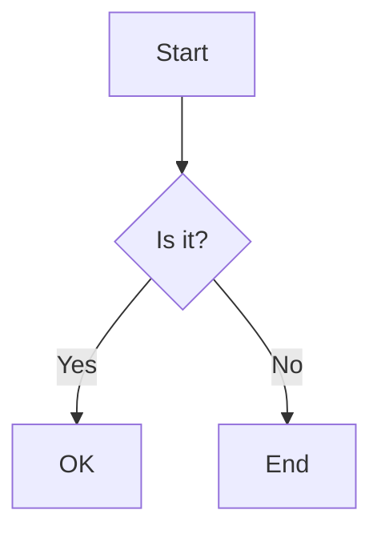

# Markdown fixture

A paragraph with **bold**, *italic*, ***both***, ~~struck~~, `inline code`, and a [link](https://example.com "title").
Autolinks: <https://pi.dev/docs>, bare https://github.com/opensec-git/Pi-Bolt and www.example.org, mail <team@example.com>.
Escapes: \*not italic\*, \_no\_, \# no heading, \[no link\], a back\\slash, 1\. not a list.
Entities: &copy; 2026 &mdash; Tom &amp; Jerry &lt;tag&gt; &#169; &#x1F680; &nbsp;done.
Hard break with two spaces  
next line, and a backslash\
third line.

## Lists

- First item
- Second item with a continuation paragraph

  This paragraph belongs to the second item.

  - Nested bullet
    1. Nested ordered one
    2. Nested ordered two
       - Third level
  - Back to the second level
- Third item
    with a lazy continuation line

1. Ordered start
1. Lazy numbering
1. Shows as 3
   ```bash
   echo "code inside a list item"
   ```

A new list after a paragraph:

7. Starts at seven
8. Eight

Task list:

- [x] Write the parser
- [ ] Add tests
  - [x] Nested done task
  - [ ] Nested open task

### Quotes

> A quote with **bold** text.
>
> > A nested quote
> > spanning two lines.
>
> - A list inside a quote
> - Second item

> [!NOTE]
> GitHub alert syntax: a note.

> [!WARNING]
> Careful with `rm -rf`.

#### Heading four
##### Heading five
###### Heading six

Setext heading
--------------

## Tables

| Left | Center | Right | Code |
|:-----|:------:|------:|------|
| a | b | 1.5 | `x \| y` |
| longer cell | **bold** | 22 | `npm test` |
| ✓ | ✗ | 300 | [link](https://example.com) |

| Name | Type | Default | Description | Since | Notes | Owner |
|------|------|---------|-------------|-------|-------|-------|
| timeoutMs | number | 30000 | How long to wait for the engine before it is restarted | 0.2.0 | Capped at 120000 | runtime |
| retries | number | 3 | Attempts before the request fails with an error shown in the transcript | 0.1.0 | — | network |

## Links and images

An inline image  inside text.


Footnote reference[^1] and another[^note].

[^1]: The first footnote.
[^note]: A named footnote with `code`.

## Math

Inline math $E = mc^2$ and \(a^2 + b^2 = c^2\), and prices like $5 and $10 stay text.

$$
\frac{-b \pm \sqrt{b^2 - 4ac}}{2a}
$$

$$\sum_{i=1}^{n} i = \frac{n(n+1)}{2} \qquad \int_0^\infty e^{-x^2}\,dx = \frac{\sqrt{\pi}}{2}$$

$$
\begin{pmatrix} a & b \\ c & d \end{pmatrix} \cdot \vec{x} = \alpha \hat{y} + \beta_{k}^{2}
$$

$$
\mathbb{R}^n \to \mathcal{O}(\log n), \quad \lim_{x \to 0} \frac{\sin x}{x} = 1
$$

## Code

```kotlin
// Kotlin
@Composable
fun Greeting(name: String, count: Int = 3): String {
    val items = listOf(1, 2.5, 0xFF, 1_000L)
    return "Hello, ${name}!\n" + items.joinToString()
}
```

```typescript
interface User { id: number; name?: string }
export async function load(id: number): Promise<User | null> {
  const re = /^user-(\d+)$/gi;
  return fetch(`/api/users/${id}`).then((r) => r.json() as Promise<User>);
}
```

```tsx
export const Button = ({ label }: { label: string }) => <button className="btn" onClick={() => alert(label)}>{label}</button>;
```

```python
@dataclass
class Point:
    x: float = 0.0
    def norm(self) -> float:
        """Euclidean norm."""
        return math.sqrt(self.x ** 2)  # comment
print(f"value={Point(3).norm():.2f}", None, True)
```

```rust
#[derive(Debug, Clone)]
pub struct Config<'a> { name: &'a str, retries: u32 }
fn main() -> Result<(), Box<dyn Error>> {
    let mut v: Vec<i64> = vec![1, 2, 3];
    println!("{:?}", v.iter().map(|x| x * 2).collect::<Vec<_>>());
    Ok(())
}
```

```go
package main

import "fmt"

func main() {
	ch := make(chan int, 3)
	defer close(ch)
	fmt.Printf("%d\n", len(ch))
}
```

```swift
struct ContentView: View {
    @State private var count = 0
    var body: some View { Text("Count: \(count)").padding() }
}
```

```java
public final class Main {
    public static void main(String[] args) throws IOException {
        System.out.println(Optional.ofNullable(args[0]).orElse("none"));
    }
}
```

```c
#include <stdio.h>
int main(void) { printf("%s\n", "hi"); return 0; }
```

```cpp
template <typename T> std::vector<T> twice(const std::vector<T>& v) { return v; }
```

```csharp
public record Person(string Name) { public override string ToString() => $"Person {Name}"; }
```

```ruby
def greet(name) = puts "Hello, #{name}" # comment
[1, 2].each { |n| greet(:sym) }
```

```php
<?php
function add(int $a, int $b): int { return $a + $b; } // sum
echo add(1, 2);
```

```bash
#!/usr/bin/env bash
set -euo pipefail
for f in *.md; do
  echo "file: $f ${HOME}" | grep -v '^#' > /dev/null && exit 0
done
```

```powershell
Get-ChildItem -Path $env:USERPROFILE -Filter *.log | Where-Object { $_.Length -gt 1MB }
```

```sql
SELECT u.id, COUNT(*) AS n FROM users u LEFT JOIN orders o ON o.user_id = u.id WHERE u.active = TRUE GROUP BY u.id; -- note
```

```json
{ "name": "pi-bolt", "version": "0.3.0", "private": true, "count": 12, "tags": ["a", null] }
```

```jsonc
// comment
{ "a": 1, /* inline */ "b": [true, false] }
```

```yaml
name: CI
on: [push]
jobs:
  build:
    runs-on: ubuntu-latest # runner
    steps:
      - uses: actions/checkout@v4
        with: { fetch-depth: 0 }
```

```toml
[package]
name = "pi"
version = "0.3.0"
edition = 2021
```

```xml
<?xml version="1.0"?>
<manifest xmlns:android="http://schemas.android.com/apk/res/android" package="in.opensec.pibolt">
  <!-- comment -->
  <uses-permission android:name="android.permission.INTERNET" />
</manifest>
```

```html
<!doctype html>
<div class="card" id="main"><a href="/x">Link &amp; more</a></div>
```

```css
.card:hover > a { color: #ff6600; margin: 0 4px !important; }
@media (max-width: 600px) { .card { display: none; } }
```

```scss
$accent: #d97757;
.btn { &:hover { color: darken($accent, 10%); } }
```

```markdown
# Title
Some **bold** and a [link](https://x.y).
- item
```

```dockerfile
FROM node:22-alpine AS build
WORKDIR /app
COPY package*.json ./
RUN npm ci --ignore-scripts
```

```makefile
build: deps
	go build -o bin/app ./cmd/app

.PHONY: build
```

```lua
local function fib(n) if n < 2 then return n end return fib(n - 1) + fib(n - 2) end -- recursion
```

```dart
void main() async { final list = <int>[1, 2]; print('sum: ${list.reduce((a, b) => a + b)}'); }
```

```ini
[server]
; comment
port = 8080
host = "localhost"
```

```diff
diff --git a/src/a.ts b/src/a.ts
--- a/src/a.ts
+++ b/src/a.ts
@@ -1,3 +1,3 @@
 const a = 1;
-const b = 2;
+const b = 3;
 export { a, b };
```

```
#!/usr/bin/env python3
import sys
def main(): print(sys.argv)
```

```js
const veryLongLine = "This line is intentionally very long so that it overflows the screen width and needs horizontal scrolling or wrapping to read it all the way to the end";
```



## Emoji and RTL

Emoji: 🚀 ✨ 👩‍💻 🇮🇳 — mixed with text.

RTL: مرحبا بالعالم and עברית in a sentence.

---

Done.
